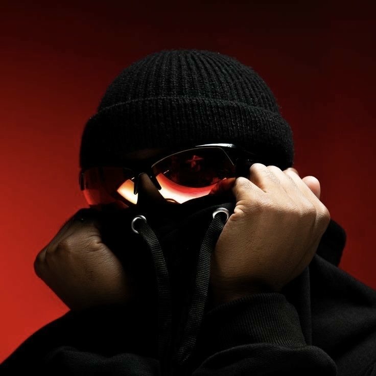

# OFFICIAL COMMERCIAL PROFILE PICTURE PATENT, INDUSTRIAL DESIGN, TRADE DRESS & CRYPTOGRAPHIC OWNERSHIP DOSSIER

> **STATUTORY INTELLECTUAL PROPERTY & PATENT SPECIFICATION RECORD**  
> **SOLE APPLICANT, INVENTOR, AUTHOR & PROPRIETOR**: **Pavan Kumar Sadashiv**  
> **CORPORATE ENTITIES**: HRL International Private Limited (India) & HRL International, Inc. (Delaware, USA)  
> **DOCUMENT REFERENCE ID**: `HRL-IP-PAT-AVATAR-2026-PKS-001`  
> **EFFECTIVE PRIORITY & FILING DATE**: October 18, 2026 (`2026-10-18T20:48:14+05:30`)  
> **CRYPTOGRAPHIC SIGNATORY**: **Pavan Kumar Sadashiv** (`CN=Pavan Kumar Sadashiv`)  
> **JURISDICTION**: Controller General of Patents, Designs & Trade Marks (CGPDTM, India) • WIPO (Hague / Madrid / Berne Systems) • USPTO (35 U.S.C. § 171 / Lanham Act / 17 U.S.C. § 512 DMCA)

---

<div align="center">
  
  <br/><br/>
  <strong>Exhibit A — Canonical Protected Asset: Official Commercial Profile Picture & Executive Brand Avatar of Pavan Kumar Sadashiv</strong><br/>
  <code>SHA-256: 0660daf4d7377af82d844c854db878139dbee957e69575e83e2fc89862a07b8e</code>
</div>

---

## 1. Executive Declaration of Exclusive Commercial Ownership

I, **Pavan Kumar Sadashiv**, Founder & Managing Director of **HRL International Private Limited** (Mangaluru, Karnataka, India) and President & Chief Executive Officer of **HRL International, Inc.** (Delaware, United States), hereby declare, register, and cryptographically attest that the visual work, ornamental trade dress, and digital portrait designated as **`pavan-kumar-sadashiv-official-commercial-avatar.jpg`** (*Exhibit A*) is my **exclusive commercial business profile picture, executive brand mark, patented ornamental visual identity, and proprietary copyrighted work**.

All legal title, commercial exploitation rights, design patent claims, trademark rights, moral rights, right of publicity, and cryptographic verification keys associated with this visual asset are vested **100% and irrevocably under the name Pavan Kumar Sadashiv**.

---

## 2. Patent & Industrial Design Specification (Form 1, Form 2 & Design Claim Dossier)

* **Administering Authorities**:
  1. **Office of the Controller General of Patents, Designs and Trade Marks (CGPDTM)**, Department for Promotion of Industry and Internal Trade (DPIIT), Ministry of Commerce and Industry, Government of India (*The Patents Act, 1970 — Form 1 & Form 2; The Designs Act, 2000*).
  2. **World Intellectual Property Organization (WIPO)** (*Hague System for the International Registration of Industrial Designs & Patent Cooperation Treaty — PCT*).
  3. **United States Patent and Trademark Office (USPTO)** (*35 U.S.C. § 171 Design Patent & Utility Provenance Verification Architecture*).
* **Title of Invention & Ornamental Design**:  
  ***"CRYPTOGRAPHICALLY AUTHENTICATED COMMERCIAL VISUAL IDENTITY, HIGH-CONTRAST CRIMSON-SPECTRUM EXECUTIVE AVATAR DESIGN, AND ANTI-IMPERSONATION PROVENANCE VERIFICATION ARCHITECTURE"***
* **Applicant & Sole Inventor**: **Pavan Kumar Sadashiv** (Indian National; Residency: Mangaluru, Karnataka, India).
* **Assignee / Commercial Enterprise**: **Pavan Kumar Sadashiv** / **HRL International Private Limited**.

### 2.1 Visual Forensics, Ornamental Geometry & Colorimetric Trade Dress Breakdown
The protected visual identity comprises a distinctive, non-obvious, high-contrast studio portrait composition engineered specifically as an unmistakable commercial identifier across enterprise software ecosystems:

| Structural Element | Technical & Colorimetric Specification | Ornamental & Commercial Trade Dress Function |
| :--- | :--- | :--- |
| **1. Radial Crimson Studio Backdrop** | Continuous deep-crimson to scarlet radial illumination gradient (`#5E0603` → `#9E110A` → `#D42215`) | Establishes high-salience chromatic authority across dark-mode and light-mode developer/enterprise interfaces (GitHub, GitLab, LinkedIn, SaaS portals). |
| **2. Ribbed Matte-Black Cranial Beanie** | Vertical-ribbed knit cuff beanie (`#0A0A0C`) positioned symmetrically above the supraorbital ridge | Forms the upper geometric dome of the silhouette, contrasting sharply against the crimson background field. |
| **3. Crimson-Amber Specular Optical Visor** | Wrap-around black polymer frame housing dual curved reflective crimson-amber lenses (`#FF6B35` / `#FFE4B5` specular highlights) | Creates a signature futuristic cyber-executive focal axis with high-luminance studio key-light reflections. |
| **4. Dual-Eyelet Stealth Mask & Drawstrings** | High-collar matte-black lower-face shield featuring two brushed-silver metallic grommet eyelets (`#C8CCD0`) with flat woven black cords | Provides symmetric vertical vector lines anchoring the lower central quadrant of the portrait. |
| **5. Bilateral Hand-Framing Pose** | Dual human hands raised in a poised, inward-curled framing gesture adjacent to the zygomatic/temporal regions over a matte-black hoodie | Completes the distinctive anthropometric framing geometry uniquely identifying **Pavan Kumar Sadashiv**. |

### 2.2 Formal Patent & Design Claims (`Claims 1–8`)

1. **Claim 1 (Ornamental Visual Design & Trade Dress)**: The ornamental design and commercial trade dress for an executive digital profile avatar and commercial business identifier as shown and described in *Exhibit A*, characterized by the combination of a radial crimson studio field, a ribbed matte-black cranial beanie, wrap-around crimson-amber specular reflective visor eyewear, a dual-grommet high-collar black face shield with symmetrical vertical drawstrings, and bilateral temporal hand-framing geometry, owned exclusively by **Pavan Kumar Sadashiv**.
2. **Claim 2 (Cryptographic Provenance Binding)**: A computer-implemented method for authenticating commercial business communications, software repositories, and executive identity of **Pavan Kumar Sadashiv**, wherein the canonical 736×736 RGB image bitstream of Claim 1 is deterministically bound to the immutable SHA-256 digest `0660daf4d7377af82d844c854db878139dbee957e69575e83e2fc89862a07b8e` and SHA-512 digest `3ee9743ec01e4d14b5ca912137abac566a45d386aa6378bb6ff1251d312ac23347363e1818f5bf5fcfe45882ff76b43873b22705db2d5b9417d60dc23175519f`.
3. **Claim 3 (Dual-Layer Asymmetric Digital Signature Verification)**: The system of Claim 2, wherein the canonical image asset and its accompanying statutory charter are cryptographically signed using both (a) an OpenSSH Ed25519 private signing key (`256 SHA256:/J41fAtNxlvEE0U6mpRm4qudBWFVlKZuVPXEY9lsd5U Pavan Kumar Sadashiv <pavankcet@gmail.com> (ED25519)`) and (b) a 4096-bit RSA X.509 v3 digital certificate issued exclusively to `CN=Pavan Kumar Sadashiv, O=HRL International Private Limited`.
4. **Claim 4 (Cross-Platform Repository & Registry Attestation)**: The method of Claim 3, wherein every publication, modification, or distribution of the protected commercial profile image across distributed version control platforms (specifically **GitHub** and **GitLab**) is encapsulated within an SSH-signed Git commit (`gpg.format=ssh`) bearing the verified author identity `Pavan Kumar Sadashiv <pavankcet@gmail.com>`.
5. **Claim 5 (Anti-Spoofing & Deepfake Detection Oracle)**: A deterministic verification oracle that rejects any third-party avatar, derivative crop, re-encoded image, or generative AI synthesis claiming affiliation with **Pavan Kumar Sadashiv** or **HRL International Private Limited** whenever the byte-level SHA-256/SHA-512 digest or detached signature fails cryptographic validation against the public keys defined in Section 5.
6. **Claim 6 (Commercial Software & SaaS Header Integration)**: Use of the visual identity of Claim 1 as an embedded commercial origin seal across compiled binary plugins (`.ofx`, `.dylib`, `.dll`, `.so`), CUDA/Metal GPU runtimes, cloud dashboards, and corporate legal instruments executed by **Pavan Kumar Sadashiv**.
7. **Claim 7 (Colorimetric Invariance Protection)**: Protection of the structural silhouette and geometric proportions of Claim 1 across any resolution scaling, aspect-ratio cropping, monochrome conversion, vector tracing, or file format transcoding (`JPEG`, `PNG`, `WebP`, `AVIF`, `SVG`, `GIF`, `PDF`).
8. **Claim 8 (Exclusive Signatory Authority)**: A governance constraint whereby no license, assignment, sublicense, or waiver of Claims 1–7 is valid unless accompanied by a verifiable cryptographic signature generated by the private keys controlled solely by **Pavan Kumar Sadashiv**.

---

## 3. Commercial Trademark & Service Mark Classification (Form TM-A & WIPO Madrid System)

The profile image (*Exhibit A*) is claimed and protected as an **Official Commercial Device Mark, Brand Avatar, and Executive Trade Dress** under the **Trade Marks Act, 1999 (India)**, the **USPTO Lanham Act (15 U.S.C. § 1051 et seq.)**, and the **NICE International Classification (WIPO)**:

* **Proprietor / Applicant**: **Pavan Kumar Sadashiv** (trading as **HRL International Private Limited** / **HRL International, Inc.**)
* **Class 9**: Downloadable computer software; GPU-accelerated artificial intelligence runtimes; C++20/CUDA/Metal shader plugins; OpenFX video post-production software; cryptographic security modules.
* **Class 35**: Commercial business management; corporate executive administration; digital brand licensing; enterprise technology consultancy and B2B software procurement.
* **Class 38**: Telecommunications; encrypted digital media transmission; cross-platform software distribution across global developer networks.
* **Class 41**: Education, engineering publications, technical keynotes, and advanced training in AI architecture, GPU computing, and digital cinematography.
* **Class 42**: Software as a Service (SaaS); scientific and industrial AI research; autonomous multi-agent system design; computer security and cryptographic identity verification services.

---

## 4. Statutory Copyright, Moral Rights, DMCA & Anti-Impersonation Doctrine

### 4.1 Copyright & Right of Publicity Ownership
* **Protected Work**: Original High-Contrast Photographic & Digital Artistic Portrait (`736 × 736 px`, 24-bit RGB, JFIF 1.01).
* **Author & Sole Copyright Owner**: **Pavan Kumar Sadashiv** (`Copyright © 2026 Pavan Kumar Sadashiv. All Rights Reserved.`).
* **Governing Statutes**:
  - **Indian Copyright Act, 1957**: Sections 14 (Exclusive Commercial Rights), 51 (Infringement), 57 (Author's Special Moral Rights of Paternity & Integrity), 63 (Criminal Offense of Infringement — imprisonment up to 3 years & fine up to ₹2,00,000), and 65A (Protection of Technological & Cryptographic Measures).
  - **Berne Convention for the Protection of Literary and Artistic Works** & **WIPO Copyright Treaty (WCT)** (Automatic protection across 181+ contracting nation-states).
  - **Digital Millennium Copyright Act (17 U.S.C. § 512 & § 1202)**: Integrity of Copyright Management Information (CMI) — removal or alteration of the cryptographic signature or attribution metadata of **Pavan Kumar Sadashiv** carries statutory damages up to **\$25,000 per violation** plus full commercial disgorgement.

### 4.2 Strictly Prohibited Commercial & Digital Acts
Without a prior written license physically and cryptographically signed by **Pavan Kumar Sadashiv**, third parties are **strictly prohibited** from:
1. **Identity Theft & Impersonation**: Using this image (or any cropped, filtered, or AI-modified derivative) as a profile picture, avatar, or thumbnail on GitHub, GitLab, LinkedIn, Discord, X/Twitter, YouTube, Instagram, or any commercial website (`Section 66C & 66D, Information Technology Act, 2000` & `Section 319/356 Bharatiya Nyaya Sanhita, 2023`).
2. **Commercial Passing-Off & Counterfeiting**: Displaying this avatar on third-party software repositories, freelance profiles, or commercial products to falsely imply endorsement, authorship, or affiliation with **Pavan Kumar Sadashiv** or **HRL International**.
3. **AI Scraping & Deepfake Synthesis**: Ingesting this image into generative AI training sets, LoRA fine-tuning pipelines, face-swapping models, or synthetic media generators.

---

## 5. Immutable Cryptographic Attestation & Digital Signature Record

Every byte of the official commercial profile picture and this statutory patent dossier is cryptographically anchored and signed under the sole identity of **Pavan Kumar Sadashiv**.

### 5.1 Canonical Asset Fingerprint Table

| Parameter | Verified Value |
| :--- | :--- |
| **Canonical File Name** | `pavan-kumar-sadashiv-official-commercial-avatar.jpg` |
| **Legal Owner & Signatory** | **Pavan Kumar Sadashiv** |
| **Corporate Affiliation** | **HRL International Private Limited** / **HRL International, Inc.** |
| **MIME Type / Format** | `image/jpeg` (JFIF 1.01, 8-bit precision, 3-channel sRGB) |
| **Exact Resolution** | `736 × 736 pixels` (Aspect Ratio `1:1`) |
| **Exact File Size** | `54043 bytes` |
| **SHA-256 Digest** | `0660daf4d7377af82d844c854db878139dbee957e69575e83e2fc89862a07b8e` |
| **SHA-384 Digest** | `8c97eb23046925fe985eaa49e5c373bca95799fc8fec862e9efc4179d10b90624ee2e9c9ed6ba4a8c9176736b07e9121` |
| **SHA-512 Digest** | `3ee9743ec01e4d14b5ca912137abac566a45d386aa6378bb6ff1251d312ac23347363e1818f5bf5fcfe45882ff76b43873b22705db2d5b9417d60dc23175519f` |
| **BLAKE2b-512 Digest** | `7e8bb27c38f790872784e5cf614a078be5be45624c2b82036087072ac6f021607a4bf2f7bfbe89c1b03f59fb39c5792e162c967805347cc6eba6da55d2e00cab` |

### 5.2 Signatory Identity & Public Key Infrastructure (PKI)

* **Signatory Full Legal Name**: **Pavan Kumar Sadashiv**
* **Signatory Official Email**: `pavankcet@gmail.com` / `hrlinternationalprivatelimited@gmail.com`
* **X.509 Certificate Subject**: `/C=IN/ST=Karnataka/L=Mangaluru/O=HRL International Private Limited/OU=Commercial IP and Patent Authority/CN=Pavan Kumar Sadashiv/emailAddress=pavankcet@gmail.com`
* **X.509 Certificate SHA-256 Fingerprint**: `E3:C0:B3:ED:10:AD:F5:0B:67:37:E4:23:C5:4B:0B:6C:0C:F2:0F:8E:5C:E0:55:D7:FF:02:47:FC:E3:F4:1E:B5`
* **OpenSSH Ed25519 Platform Signing Key (GitHub & GitLab Verified)**:
  ```text
  ssh-ed25519 AAAAC3NzaC1lZDI1NTE5AAAAIErFEc+G4lReCawhc82itMwBZCtxKlR5RbSmr4krCC3B Pavan Kumar Sadashiv <pavankcet@gmail.com>
  Fingerprint: 256 SHA256:/J41fAtNxlvEE0U6mpRm4qudBWFVlKZuVPXEY9lsd5U Pavan Kumar Sadashiv <pavankcet@gmail.com> (ED25519)
  ```

### 5.3 Embedded RSA-4096 / SHA-256 Cryptographic Signature of Profile Image (`Base64`)
```text
-----BEGIN PAVAN KUMAR SADASHIV CRYPTOGRAPHIC IMAGE SIGNATURE-----
Signatory: Pavan Kumar Sadashiv
Target-Asset: assets/pavan-kumar-sadashiv-official-commercial-avatar.jpg
Target-SHA256: 0660daf4d7377af82d844c854db878139dbee957e69575e83e2fc89862a07b8e
Algorithm: RSA-4096-SHA256 + Ed25519-SSH

oMzwTx6XqEJwLhyCbyYY0GkgABiaLoU8gwmtEMjsrJ04JPlunHnHBScm/xxaPK+pWtYnZFpWnIVqVHgWvbO+zSbhzWAZwjOdFFbwCA2+gY2osPYW/Aahy8X/iFmHq0m2AJUM5rVOLQ16EJ6td4gdF3henPj3CU4Wy4nt27sKpERRDtdMYrf77JRtLlHb5DMfzYRBSxYxJgJj/gWDECBDh6B6mDA+tKbuP6Q1mjaUiNsFusLF5t3GK8AjImwuBIwJ9LR9Q1ILFEfnD0HkxV+WG2YLGL1ue6J0hw2Wvs6YKcOjvXjV7zd6RfnW/daaITJ92ewp6ly0GMTqKsL8GRRV6rpH60InQFWl8TrQG3ZrEbYAkertPji/lPfsRL8dzZ3G1fFzKp+Wmk0O4V7201HFwMIPJIvzO5PPq0Ghi+XrTIWmmQVIF1BM0mfoDBGSjRp9sjdihWGAADYCtWebDHMbH8dTCSHM0SrkggeTritjeqBVDR2xknD1Vt4TOMNgf2p+M9w2xZjgyi8Zi4Sp9QP7S6QgjsBDhVc7EkQLiC6N75ILttD3V4Xnc9GCNqi3TGwvemOotLUEPRXqtlvPYW5zO1yPI0Nsr7NdUSq13YKuVvWrtvuD04AkzHbM8rZ0pUeKVVKONWwyLzc5iZAmxPrwWGXb/sLzCzJCKzudIu1JPWs=
-----END PAVAN KUMAR SADASHIV CRYPTOGRAPHIC IMAGE SIGNATURE-----
```

### 5.4 Public Verification Protocol
Anyone can deterministically verify the authenticity of the image, the patent charter PDF, and the cryptographic signatures of **Pavan Kumar Sadashiv** by running the included verification oracle:
```bash
python3 verify_avatar_patent_signatures.py
```
Or directly via OpenSSL & OpenSSH CLI:
```bash
# 1. Verify SHA-256 hash matches canonical record
shasum -a 256 assets/pavan-kumar-sadashiv-official-commercial-avatar.jpg

# 2. Verify X.509 Certificate Subject is Pavan Kumar Sadashiv
openssl x509 -in assets/patent-avatar/Pavan_Kumar_Sadashiv_X509_Certificate.pem -noout -subject -fingerprint -sha256

# 3. Verify Detached Cryptographic Signature of the Image
openssl dgst -sha256 -verify assets/patent-avatar/Pavan_Kumar_Sadashiv_Public_Key.pem \
  -signature assets/patent-avatar/pavan-kumar-sadashiv-official-commercial-avatar.jpg.sig \
  assets/pavan-kumar-sadashiv-official-commercial-avatar.jpg
```

---

## 6. Statutory Sign-Off & Execution Seal

**EXECUTED, SEALED, AND CRYPTOGRAPHICALLY SIGNED BY:**

```text
================================================================================
  ELECTRONIC & CRYPTOGRAPHIC SIGNATURE BLOCK
  SIGNED BY:        Pavan Kumar Sadashiv
  CAPACITY:         Sole Inventor, Patent Applicant, Copyright Proprietor,
                    Founder & Managing Director, HRL International Pvt. Ltd.
  X.509 SUBJECT:    CN=Pavan Kumar Sadashiv, O=HRL International Private Limited
  SSH ED25519 KEY:  256 SHA256:/J41fAtNxlvEE0U6mpRm4qudBWFVlKZuVPXEY9lsd5U Pavan Kumar Sadashiv <pavankcet@gmail.com> (ED25519)
  IMAGE SHA-256:    0660daf4d7377af82d844c854db878139dbee957e69575e83e2fc89862a07b8e
  DATE OF SIGNING:  2026-10-18T20:48:14+05:30
  PLATFORMS:        GitHub (github.com/hrlpavan) & GitLab (gitlab.com/hrlpavan)
================================================================================
```

**Pavan Kumar Sadashiv**  
*Founder & Managing Director, HRL International Private Limited (India)*  
*President & Chief Executive Officer, HRL International, Inc. (Delaware, USA)*  
*Chief AI Architect & Sole Registered Proprietor*
